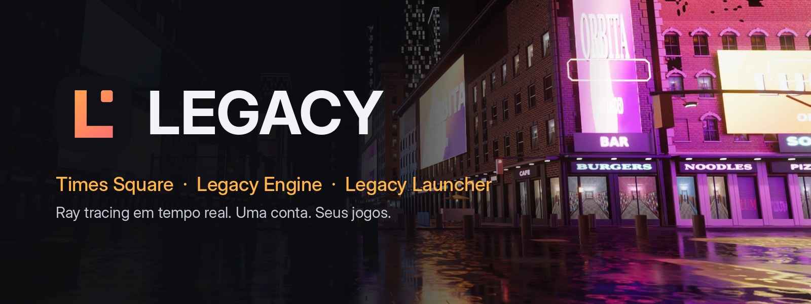
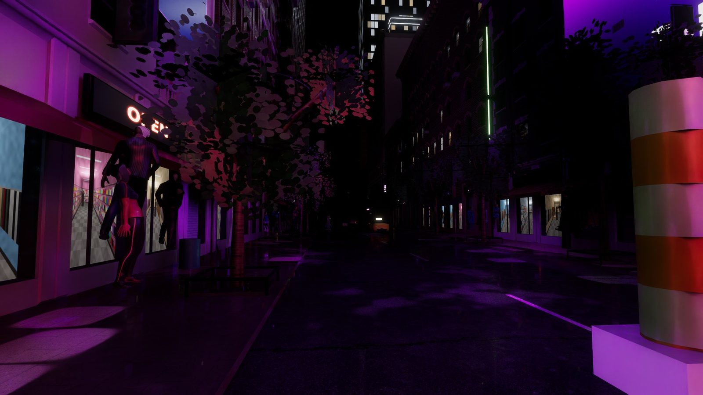
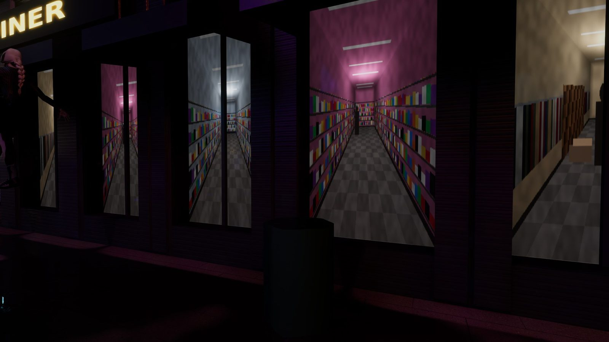
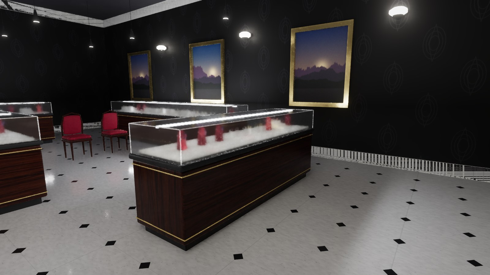
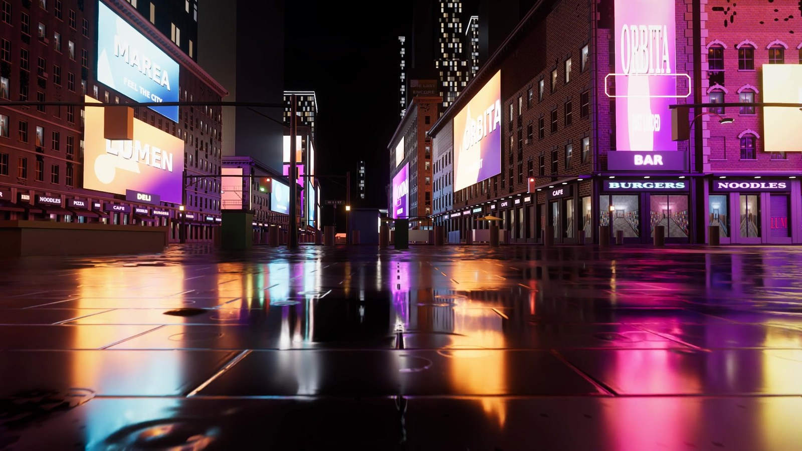
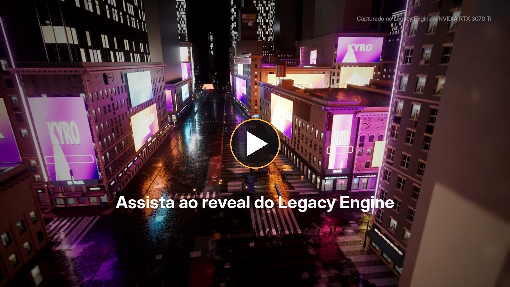
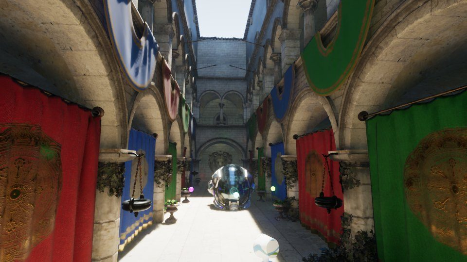
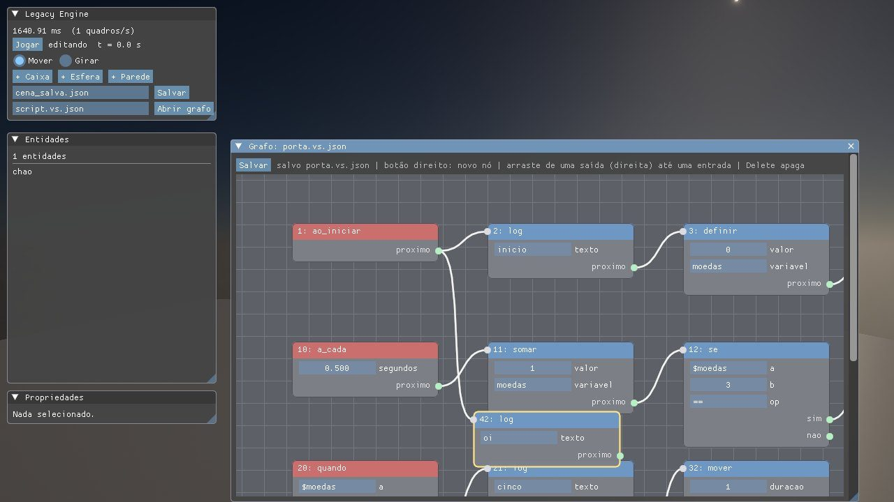

  

  

  <a href="https://legacyengine.com.br"><b>legacyengine.com.br</b></a> ·
  <a href="https://github.com/seronzera/legacy/releases">Todas as versões</a> ·
  <a href="https://legacyengine.com.br/termos">Termos de Uso</a> ·
  <a href="https://legacyengine.com.br/privacidade">Privacidade</a>

---

##  Times Square

**A praça mais iluminada do mundo, numa noite de chuva.** Cada telão, cada letreiro de neon e cada poste é uma luz de
verdade, com sombra, e o asfalto molhado reflete tudo, traçado raio por raio.

| | |
|:---:|:---:|
|  |  |
| **Lanchonete por dentro** | **Loja de roupas por dentro** |
|  |  |
| **Vitrines de vidro de verdade** | **O asfalto vira espelho na chuva** |

- **139 telões** e **68 letreiros de neon** acesos
- **1.600 luzes**: cada poste e cada loja ilumina de verdade, com sombra
- **70 lojas com interior 3D**: lanchonete, café, farmácia, joalheria, roupas e conveniência, de portas abertas
- **Chuva de verdade**: poças e reflexos traçados por raios de luz
- **Trânsito e multidão**: carros, táxis, ônibus e milhares de pessoas pelas calçadas, que abrem espaço e reagem a um esbarrão
- **Cidade viva** *(na próxima atualização)*: cada pessoa na rua tem nome e rotina. Quem você viu de manhã indo trabalhar
  está no lugar certo à tarde, as lojas têm por dentro os clientes que entraram da rua, e quem conversa com você lembra
  de você depois
- **Metrô** *(na próxima atualização)*: desça pelas entradas com globo verde, espere na plataforma da Times Sq-42 St
  e viaje em pé dentro do vagão até a 49 St
- **Crime e fuga** *(na próxima atualização)*: testemunhas descrevem sua roupa, câmeras gravam, a polícia se protege
  atrás dos carros, cerca pelos lados e chega de helicóptero
- **Neve e replay** *(na próxima atualização)*: pegadas e rastros de pneu na neve, e os últimos 15 segundos para rever
  de qualquer ângulo no modo foto
- **Batidas e tiroteios** *(na próxima atualização)*: a lataria amassa onde bateu e puxa a direção; armado, você mira
  com o corpo inteiro, e a polícia mira em você
- **Trânsito e destruição** *(na próxima atualização)*: carros ultrapassam e fazem a curva nos cruzamentos; o que quebra
  se parte em pedaços de verdade
- **Rostos que falam** *(na próxima atualização)*: emoções, rugas de expressão, boca que acompanha a voz e olhos que
  olham para você
- **Grátis**, e dá para jogar como visitante, sem criar conta

---

##  Legacy Engine

**Luz de verdade. Medida.** O motor por trás da Times Square: C++ e Vulkan com ray tracing em todo pixel. Cada
sistema de luz é comparado automaticamente com uma simulação física de referência (path tracing); se desviar, o
teste falha.

<table>
<tr>
<td align="center" width="25%"><h2>60 q/s</h2>ray tracing completo em 1080p numa RTX 3070 Ti¹</td>
<td align="center" width="25%"><h2>6%</h2>de distância da referência por path tracing, a 60 q/s¹</td>
<td align="center" width="25%"><h2>76.000</h2>triângulos emissivos iluminando a cena, cada um com sombra²</td>
<td align="center" width="25%"><h2>151 mi</h2>triângulos num quadro, desenhados em 4,1 ms³</td>
</tr>
</table>

| | |
|:---:|:---:|
|  |  |
| **Mil luzes, todas com sombra.** Todo objeto que emite luz ilumina a cena de verdade, sem pré-cálculo. | **Geometria densa.** Milhões de triângulos por quadro, com nível de detalhe automático. |
|  |  |
| **Editor visual.** Monte cenas, scripts e materiais sem sair do motor. | **Oceano, nuvens e céu físicos**, sem bake. |

**População virtualizada.** Cada habitante da cidade é calculado a partir do tempo, sem ficar guardado na memória:
1 milhão de pessoas cabem em 8 MB e cada uma vive a própria rotina, mesmo longe da câmera. Quem testemunha um crime
pode ligar para a polícia, conta para os colegas, e lembra do jogador.

**Personagens com captura.** Rostos com 34 unidades de expressão e rugas que surgem onde a pele vinca; captura facial
a partir de um vídeo de celular; rosto escaneado registrado no corpo (forma e cor da pessoa, com as expressões
valendo); ações de captura de movimento de vários esqueletos no mesmo personagem; IK de corpo inteiro.

**Sem bake:** arraste o sol, acenda uma luz, derrube uma parede: sombras, reflexos e luz global se atualizam no
mesmo quadro.

`Editor visual` `Scripts Lua` `Script visual` `Materiais por nós` `Física Jolt` `Veículos` `Ragdoll` `Áudio 3D`
`IA e navegação` `Multijogador` `Mundo aberto` `Multidões` `DLSS 4` `FSR 3` `Exportação de jogos`
`Motion matching` `Captura facial` `Rosto escaneado` `Lataria que amassa` `Água com empuxo` `Terreno com cavernas`
`Cidade procedural` `FBX e OBJ` `Loja de assets`
`Destruição em pedaços` `Tecido` `Níveis transmitidos`

¹ Cena Bistro (Amazon Lumberyard, CC BY 4.0), 1920×1080, preset Médio, RTX 3070 Ti: 16,7 ms por quadro; erro =
diferença média de luminância contra path tracing de 512 quadros. ² Bistro à noite, luzes de malha. ³ Campo de
rochas: G-buffer em 4,1 ms contra 24,7 ms da malha completa, RTX 3070 Ti.

---

##  Legacy Launcher

**Uma conta. Tudo num lugar.**

- **Conta Legacy única:** o mesmo nome e as mesmas configurações no launcher, nos jogos e no Legacy Engine
- **Atualiza sozinho:** quando sai uma versão nova, baixa só os arquivos que mudaram
- **Sua biblioteca:** instale, jogue, atualize e desinstale com um clique
- **Sem internet?** O que já está instalado continua jogável offline

  

---

## Requisitos

| | |
|---|---|
| Sistema | Windows 10 ou 11, 64 bits |
| Placa de vídeo | Com ray tracing: NVIDIA RTX 20xx ou mais nova, AMD RX 6000 ou mais nova, ou Intel Arc |
| Referência | Times Square na qualidade Média em 1080p: RTX 3070 Ti, cerca de 36 quadros por segundo |

## Perguntas frequentes

<b>É grátis?</b>

Sim. O Legacy Launcher e a Times Square são gratuitos.

<b>Preciso criar conta?</b>

Para jogar a Times Square, não: entre como visitante. A conta Legacy (só e-mail, senha e um username) guarda sua
biblioteca e suas configurações em qualquer computador e é necessária para o Legacy Engine.

<b>O Windows avisou que o arquivo é desconhecido. É seguro?</b>

O aviso aparece com programas novos que ainda não têm assinatura digital paga. Baixe sempre por esta página ou pelo
site oficial. Na janela do aviso, clique em "Mais informações" e depois em "Executar assim mesmo".

<b>Como funcionam as atualizações?</b>

Automáticas. O launcher se atualiza sozinho e, quando um jogo tem versão nova, baixa só os arquivos que mudaram. Seus
saves e configurações não são tocados.

<b>Quanto vale o projeto?</b>

Reconstruir o Legacy do zero nos EUA custaria cerca de **US$ 5,59 milhões**: 294 meses de engenharia, ou 13
engenheiros por quase dois anos. [Veja a conta completa e as fontes](VALOR.md).

---

© 2026 Legacy · Todos os direitos reservados. 
Este repositório distribui apenas os instaladores oficiais. O código-fonte não é público.

